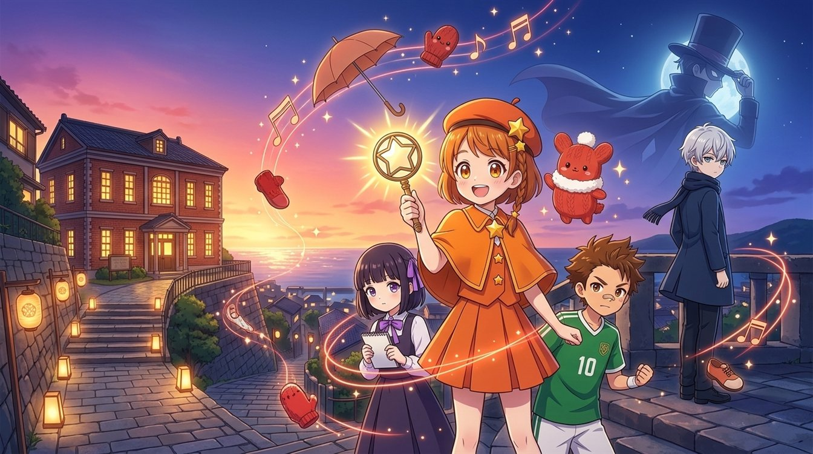
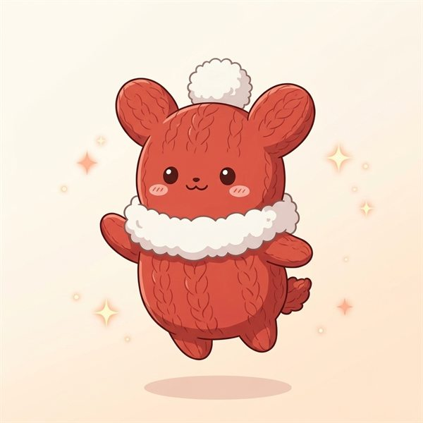
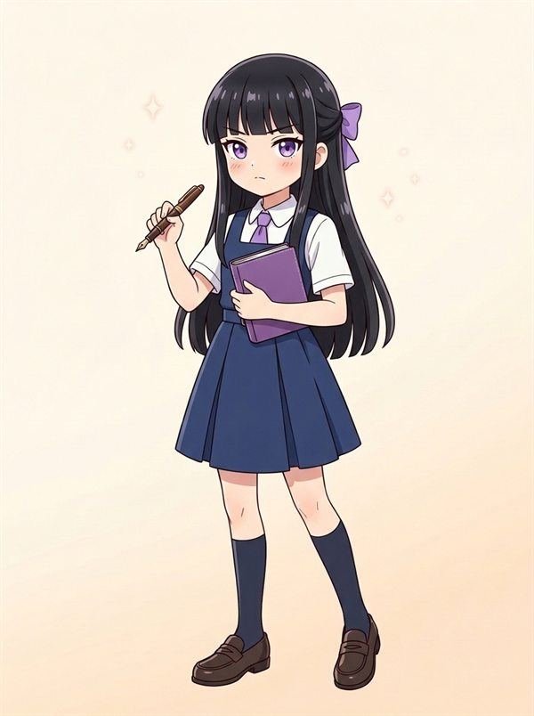
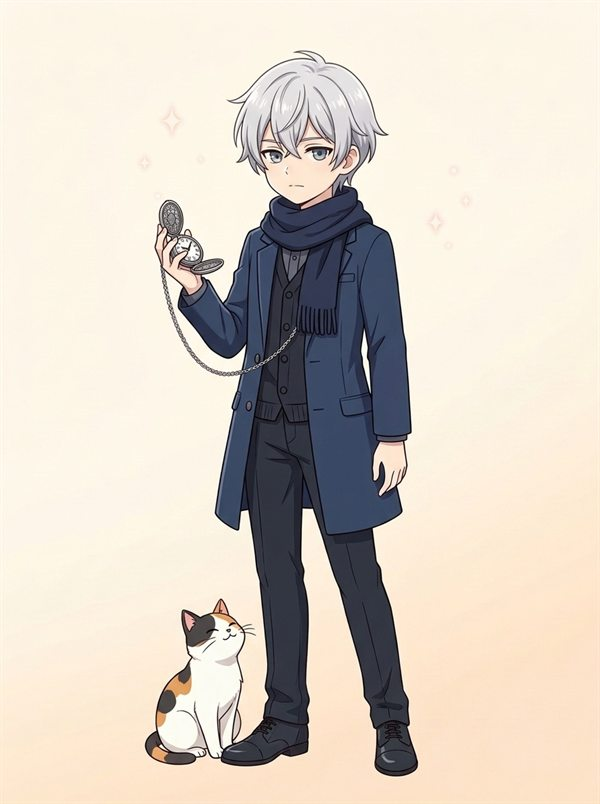
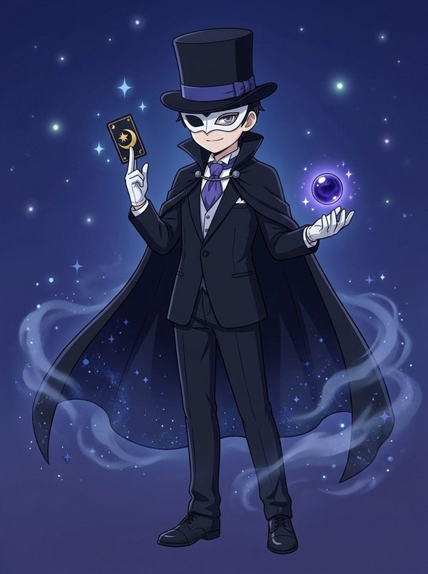

<p align="center">
  <a href="https://pocke.ecolifechallenge.com/"></a>
</p>

<h1 align="center">ポッケと わすれもの探偵団</h1>
<p align="center"><b>Pocke &amp; the Lost-and-Found Detectives</b></p>
<p align="center">夕方5時のチャイムが鳴ったら、わすれものが話しだす。<br>
全12話・無料で読めるオリジナルアニメ原作（小学生向け）</p>

<p align="center">
  <a href="https://pocke.ecolifechallenge.com/ja/"><b>📖 日本語で読む</b></a> ・
  <a href="https://pocke.ecolifechallenge.com/en/"><b>📖 Read in English</b></a> ・
  <a href="https://ofuse.me/2973d74a"><b>💌 OFUSEで応援する</b></a>
</p>

---

## ものがたり

海が見える坂の町・月見坂。小学5年生の星川こはるは、毎日なにかを忘れてしまう「忘れものの天才」。

ある日の夕方5時、町にゆうやけチャイムが鳴りひびいたとき――こはるの耳に、ちいさな声が聞こえてきた。
「……さむいよう。だれか、見つけて……」

声をたどった坂の上に現れたのは、百年分のわすれものが眠る、ふしぎな赤レンガの「わすれもの館」。そこで出会ったのは、片っぽだけの赤い手ぶくろの精・ポッケだった。

町の人の「いちばん大切な思い出」を盗む怪盗ミッドナイトの正体とは？　わすれもの探偵団の、ちょっぴりふしぎで、あったかい事件簿がはじまる！

## キャラクター

| | | | |
|:-:|:-:|:-:|:-:|
| <br>**星川こはる**<br>主人公・小学5年生<br>「その"わすれもの"、わたしが届けます！」 | <br>**ポッケ**<br>手ぶくろの付喪神<br>「まかせるポケ！」 | <br>**九条アヤメ**<br>学級委員・頭脳派<br>「証拠は、うそをつかないわ」 | <br>**犬飼タイガ**<br>幼なじみ・サッカー少年<br>「オレにまかせろ！」 |
| <br>**夜見カナタ**<br>なぞの転校生<br>「……別に。」 | <br>**怪盗ミッドナイト**<br>なぞの怪盗<br>「今宵の思い出、いただいていく。」 | <br>**シオリさん**<br>わすれもの館の館長<br>「あらあら、すてきなお客さまですこと。」 | <br>**こはる（探偵モード）**<br>「星めがね、オープン！」 |

## エピソード（全12話）

| 話 | タイトル |
|---|---|
| 第1話 | [ゆうやけチャイムと しゃべる手ぶくろ](https://pocke.ecolifechallenge.com/ja/ep01/) |
| 第2話 | [転校生は、止まった時計](https://pocke.ecolifechallenge.com/ja/ep02/) |
| 第3話 | [アヤメの推理ノート](https://pocke.ecolifechallenge.com/ja/ep03/) |
| 第4話 | [タイガと おじいちゃんのボール](https://pocke.ecolifechallenge.com/ja/ep04/) |
| 第5話 | [雨の日の 片っぽぐつ](https://pocke.ecolifechallenge.com/ja/ep05/) |
| 第6話 | [アヤメの誕生日と 消えた約束](https://pocke.ecolifechallenge.com/ja/ep06/) |
| 第7話 | [怪盗ミッドナイトの正体](https://pocke.ecolifechallenge.com/ja/ep07/) |
| 第8話 | [わすれもの館の ひみつ](https://pocke.ecolifechallenge.com/ja/ep08/) |
| 第9話 | [学芸会と 星のランタン](https://pocke.ecolifechallenge.com/ja/ep09/) |
| 第10話 | [だれも、カナタをおぼえていない](https://pocke.ecolifechallenge.com/ja/ep10/) |
| 第11話 | [たそがれの国へ](https://pocke.ecolifechallenge.com/ja/ep11/) |
| 第12話 | [その手ぶくろ、ずっと覚えてる](https://pocke.ecolifechallenge.com/ja/ep12/) |

対応言語：日本語（原作）／English／简体中文／繁體中文／한국어／Español／Français／Português（ブラウザの言語で自動的に切り替わります）

---

## English

**Pocke & the Lost-and-Found Detectives** is a 12-episode original anime story for kids. Forgetful fifth-grader Koharu can hear the voices of lost things when the 5 o'clock sunset chime rings. With Pocke, the spirit of a single red mitten, and her friends, she takes on Phantom Thief Midnight, who steals people's most precious memories. Free to read in 8 languages at **https://pocke.ecolifechallenge.com/**.

---

## リポジトリ構成（制作者向け）

```
chapters/<lang>/epXX.md   本文（ja が原作。en, zh-hans, zh-hant, ko, es, fr, pt は翻訳）
content/i18n/<lang>.json  サイトの文言・キャラクター紹介・あらすじ
notes/                    市場調査・キャラクター・世界観・プロット・用語集・進捗
assets/characters, originals  生成した原画
assets/web/               Web用に書き出した画像・OGP・ファビコン（tools/images.ps1, tools/og.mjs）
site/                     CSS / JS（GA4イベント計測）
tools/build.mjs           静的サイト生成 → docs/（GitHub Pages の公開フォルダ）
tools/kanji_check.mjs     常用漢字・文字数チェッカー
```

```powershell
powershell -ExecutionPolicy Bypass -File tools/images.ps1   # 画像の書き出し
node tools/og.mjs                                         # OGP画像・favicon.ico
node tools/build.mjs                                      # docs/ を生成
node tools/serve.mjs                                      # http://localhost:8080/ で確認
node tools/kanji_check.mjs chapters/ja/ep01.md            # 常用漢字チェック
```

### GA4 で計測しているイベント（G-23P7G6C6E9）
| イベント名 | 内容 |
|---|---|
| `episode_start` | エピソードを開いた（`episode_number`, `is_reread`） |
| `episode_progress` | 本文を 25/50/75/90% まで読んだ（`percent_read`） |
| `episode_complete` | 最後まで読んだ（`read_seconds`, `episodes_completed`） |
| `series_complete` | 最終話を読み終えた |
| `next_episode_click` / `prev_episode_click` / `episode_list_click` | エピソード間の移動 |
| `cta_read_click` | トップの「読む」ボタン（`placement`: hero / hero_continue） |
| `ofuse_click` / `ofuse_impression` | OFUSE 応援ボタンのクリック／表示（`placement`） |
| `share` | シェア（`method`: x / line / facebook / copy_link / web_share） |
| `character_view` | キャラクターカードを開いた（`character_id`） |
| `select_language` / `language_auto_detect` | 言語の手動切り替え／自動判定 |
| `section_view` / `faq_open` / `font_size_change` | トップの各セクション到達・FAQ・文字サイズ |

全イベントに `language` パラメータが付きます。GA4 の管理画面で、`episode_number`・`percent_read`・`placement`・`method`・`character_id`・`language` をカスタムディメンションに登録すると分析しやすくなります。子ども向けサイトのため、Google シグナルと広告のパーソナライズは無効にしています。

© 2026 ポッケと わすれもの探偵団
